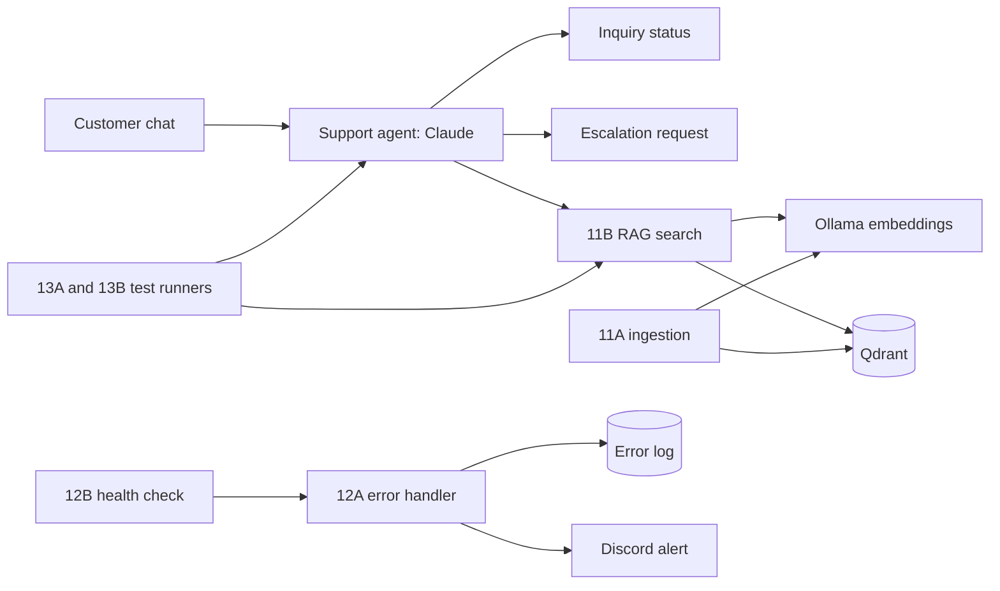

# AI Customer Support Agent (n8n, Claude, RAG)

A support agent that answers only from a verified knowledge base, declines what
it cannot verify, and alerts me when something breaks.
**100% Top-1 retrieval, 100% regression pass rate over 7 tests, and outage
replies in 2 seconds instead of hanging.**

## The problem
Support chatbots either invent policies or fail silently. This project shows an
agent that is grounded in retrieved articles, safe when its tools fail, and
covered by automated tests.

## What it does
- Retrieves support articles by meaning (embeddings), not by keyword or category
- Answers from those articles and says so when the knowledge base has no answer
- Refuses unsafe and out-of-scope requests
- Detects failures, logs them, and sends a Discord alert
- Re-checks its own dependencies every 15 minutes
- Runs a [N]-case regression suite on demand

## Results
| Metric | Result |
| --- | --- |
| Top-1 retrieval accuracy | 100% |
| Recall@3 | 100% |
| Regression pass rate (5 runs) | 92% to 100% |
| Flaky tests found and fixed | 1 |
| Reply time with a dependency down | 2 s (was a hang of 175+ s) |
| Failure types caught by the suite | 3 of 3 deliberate breaks |

## Architecture

## Run it yourself
1. `cp .env.example .env` and set `N8N_ENCRYPTION_KEY`
2. `docker compose up -d`
3. `docker compose exec ollama ollama pull nomic-embed-text`
4. Open http://localhost:5678, import the files in `workflows/`
5. Create credentials: Anthropic, Qdrant (`http://qdrant:6333`), Ollama
   (`http://ollama:11434`), Discord webhook
6. Import `data/*.csv` into n8n Data Tables, then run workflow 11A
7. Chat with workflow 10, or run 13A to execute the test suite

## Reliability
- Central error workflow logs every failure and alerts within seconds
- Health check verifies Qdrant, the collection, Ollama and the model
- Pre-flight check fails fast when Ollama is down; workflow timeouts cap waits
- Agent retries reads once and never repeats writes
- Recovery steps are in `docs/runbook.md`

## Testing
12 cases: retrieval, answerable questions, refusals, out-of-scope requests and
unclear input. 13A checks replies, 13B scores retrieval. Tests were verified by
deliberately breaking assertions, expectations and the system.

## Limitations
- Keyword assertions confirm key facts and refusals, not full answer quality
- Four-article knowledge base; scores will change with a larger one
- Alerts repeat every 15 minutes during an outage

## Stack
n8n, Claude (Anthropic API), Ollama (nomic-embed-text), Qdrant, Docker Compose
